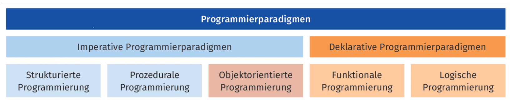
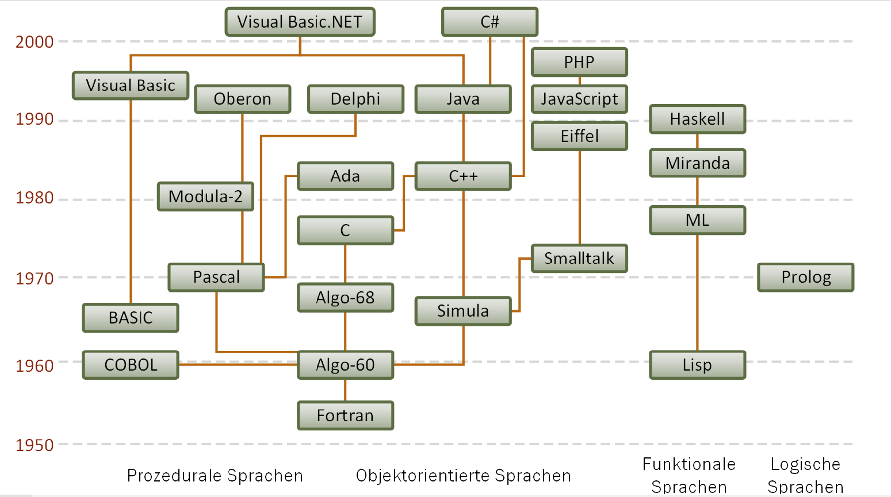

# Programmierparadigma

## Was ist ein Programmierparadigma?

Ein Programmierparadigma ist ein Programmierstil, der Entwickler\*innen bei der Erstellung von Code unterstützt, indem das Paradigma grundlegende Regeln aufstellt.

### Strukturierte Programmierung

Die strukturierte Programmierung ist eine Weiterentwicklung der imperativen Programmierung. In **BASIC** gab es damals nur Sprungmarken bzw. GOTO-Anweisungen. Diese gelten als gefährlich, da eine GOTO-Anweisung auf eine beliebige Zeile verweist und nicht auf eine abgeschlossene Funktion. Dadurch entsteht schnell unübersichtlicher „Spaghetti-Code“, und man springt leicht an eine Stelle, die etwas Falsches ausführt. Edsger W. Dijkstra veröffentlichte 1968 den Aufsatz **Go To Statement Considered Harmful**. Statt Sprüngen sollen Kontrollstrukturen wie **IF**, **CASE**, **WHILE**-Schleifen und **REPEAT** verwendet werden. Diese Konzepte erweiterten die imperativen Programmiersprachen.

### Prozedurale Programmierung

Ein Programm besteht nicht mehr aus einem einzigen großen Block, sondern wird in mehrere kleine Teile aufgespalten, sogenannte Prozeduren. Prozeduren sind Vorläufer von Funktionen und mittlerweile in fast jeder Sprache vertreten. Sie ermöglichen es, Algorithmen in kleinere, wiederverwendbare Teillösungen zu zerlegen.

### Funktionale Programmierung

Bei der funktionalen Programmierung besteht ein Programm aus Funktionen, die wie Werte behandelt werden: Sie können anderen Funktionen übergeben, von ihnen zurückgegeben und miteinander kombiniert werden. Idealerweise haben die Funktionen keine Seiteneffekte, d. h. sie liefern bei gleicher Eingabe immer dasselbe Ergebnis und verändern keine Daten außerhalb der Funktion.

### Logische Programmierung

Programme werden als logische Aussagen formuliert, also als **Fakten** und **Regeln** (z. B. in **Prolog**). Man beschreibt nicht, *wie* ein Problem gelöst wird, sondern *was* gilt. Die Lösung leitet das System anschließend selbst aus den Fakten und Regeln her.

## Objektorientierung

Bei komplexen Systemen werden Gegenstände aus der echten Welt als Objekte abgebildet. Diese Objekte haben Attribute (Eigenschaften) und Methoden, die sie ausführen können.

### Objektorientierte Programmierung

Die objektorientierte Programmierung (OOP) baut auf der Objektorientierung auf. Dabei wird versucht, die Architektur einer Software an der realen Welt auszurichten. Zentrale Konzepte sind Abstraktion, Kapselung, Vererbung und Polymorphie.

